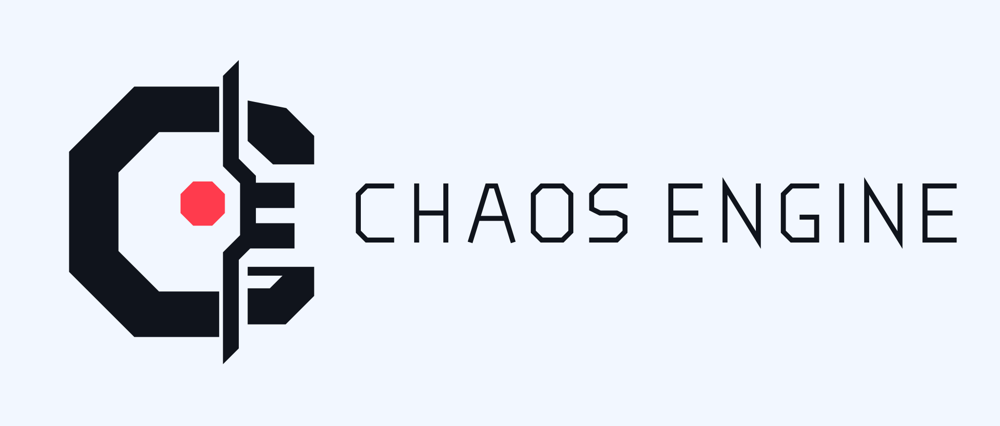

<p align="center">
  <picture>
    <source media="(prefers-color-scheme: dark)" srcset="assets/brand/lockup-dark.svg">
    <source media="(prefers-color-scheme: light)" srcset="assets/brand/lockup-light.svg">
    
  </picture>
</p>

# ChaosEngine

ChaosEngine is a portable, provider-neutral working contract for software agents. Testers, developers, product owners and scrum masters install it into a project so their coding agents (Claude Code, Codex, Gemini CLI, Grok, GitHub Copilot, OpenCode, Cursor, Grok Bot) follow one loop: research first, plan, implement, verify with evidence, get an adversarial review, and record what was learned. Agents load [skills/chaos-engine/SKILL.md](skills/chaos-engine/SKILL.md); people start with the [overview](guides/overview.md).

ChaosEngine sends no usage data.

## Quick start

There are two install channels:

- **Latest from `main` (available now):** the one-liner below. Run it in your project directory; no Python is needed beforehand. It installs from this repository's `main` and pins the exact commit in the install receipt.
- **Weekly releases (not live yet):** the `chaosengine-harness` packages on PyPI and npm. Today they are reserved `0.0.1` placeholders that do not install this harness.

macOS or Linux:

```bash
curl -fsSL "https://raw.githubusercontent.com/ShaftHQ/chaosengine-harness/main/install.sh" | bash -s -- "https://raw.githubusercontent.com/ShaftHQ/chaosengine-harness/main/install.sh"
```

Windows PowerShell:

```powershell
irm "https://raw.githubusercontent.com/ShaftHQ/chaosengine-harness/main/install.ps1" | iex
```

## Pin, verify, uninstall

`--version <40-hex>` pins a commit. A release pin is refused when its `.sha256` does not match. `verify` names drift. `uninstall` keeps edited files. A SHAFT project gets version-pinned skills; `--without-shaft-engine-users` opts out until `--with-shaft-engine-users`.

The installer runs doctor before it finishes. For later health checks, see [INSTALL.md](INSTALL.md).

## Docs

- [Overview](guides/overview.md): roles, the delivery loop, supported hosts, concepts, status
- [INSTALL.md](INSTALL.md): host flags, add-ons, offline bundles, upgrade, rollback, uninstall
- [Architecture](guides/architecture.md): lifecycle, ownership, trust boundaries, companions
- [CHANGELOG.md](CHANGELOG.md): version `0.4.20261115.5` ([VERSION](VERSION))
- Role starts: [tester](guides/start-tester.md), [frontend developer](guides/start-frontend-developer.md), [backend developer](guides/start-backend-developer.md), [product owner](guides/start-product-owner.md), [scrum master](guides/start-scrum-master.md)
- Tool pages: [Grok](guides/tools/grok.md), [Claude Code](guides/tools/claude.md), [Codex](guides/tools/codex.md), [Gemini CLI](guides/tools/gemini.md), [Cursor](guides/tools/cursor.md)

## Contributing and license

See [CONTRIBUTING.md](CONTRIBUTING.md), [CODE_OF_CONDUCT.md](CODE_OF_CONDUCT.md), [SECURITY.md](SECURITY.md) and the generated [ROADMAP.md](ROADMAP.md). MIT licensed, copyright ChaosEngine contributors: [LICENSE](LICENSE), [THIRD_PARTY_NOTICES.md](THIRD_PARTY_NOTICES.md).

[Source inventory](docs/source-inventory.md).
