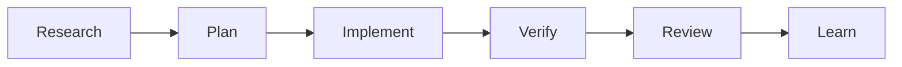

# Delivery loop

Source of truth: [router](../../skills/chaos-engine/SKILL.md#check-and-deliver), [overview](../../guides/overview.md).

Work is researched, planned, implemented, verified, reviewed, and learned. A pending check is not done.

Hook hosts run the guard from SessionStart. Hookless hosts run `tool.py entry` and record the same receipts.

## Next steps

- [How ChaosEngine thinks](how-chaosengine-thinks.md)
- [Choose a workflow](../how-to/choose-a-workflow.md)
