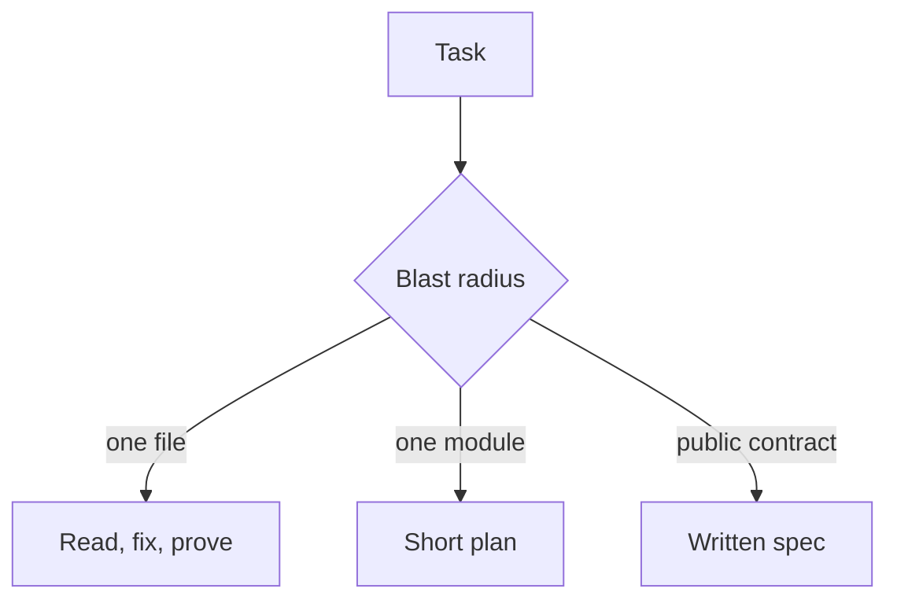

# How ChaosEngine thinks

Source of truth: [identity](../../identity.md#principles), [router](../../skills/chaos-engine/SKILL.md#triage).

ChaosEngine sizes the task before it edits. A small task stays small. A public contract gets a written spec. The ethics floor does not move.

One file is reversible, so read it, fix it, and prove it. One module needs a short plan. A public contract or a hard-to-reverse change needs a written spec and an owner decision where the spec asks for one.

The router owns the delegation rule. This page does not restate it. Open [the delegation ladder](../../skills/chaos-engine/SKILL.md#delegation-ladder) when you need the rungs.

Two failed attempts on one approach mean stop patching and re-plan. Push back on a risky pick. The owner decides.

## Next steps

- [Delivery loop](delivery-loop.md)
- [Settings reference](../reference/settings.md)
- [Keywords glossary](../reference/keywords.md)
