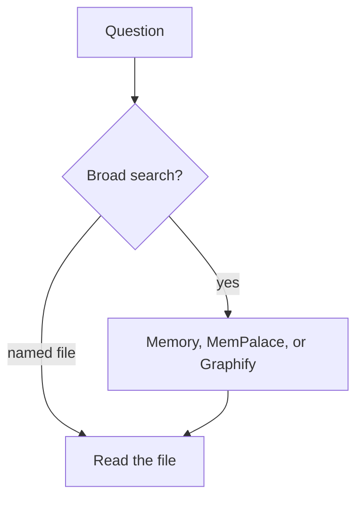

# Memory and retrieval

Source of truth: [retrieve-first](../../references/retrieve-first.md).

Retrieve before a broad search. Memory, MemPalace, and Graphify answer different questions. The file on disk still wins when they disagree.

Record `retrieve: used`, `retrieve: skipped`, or `retrieve: exempt(harness)`.

## Next steps

- [How ChaosEngine thinks](how-chaosengine-thinks.md)
- [Delivery loop](delivery-loop.md)
