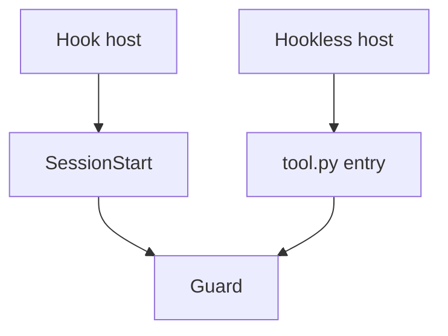

# Safety gates

Source of truth: [ethics card](../../companions/ethics-card.md), [router](../../skills/chaos-engine/SKILL.md#check-and-deliver).

Hook hosts run the guard from the host lifecycle. Hookless hosts run `tool.py entry` and record the same receipts.

The ethics floor blocks person-only exams and live answer feeds. The delete guard and the secret guard stay on unless the owner turns a documented switch off.

## Next steps

- [How ChaosEngine thinks](how-chaosengine-thinks.md)
- [Status codes](../reference/settings.md)
