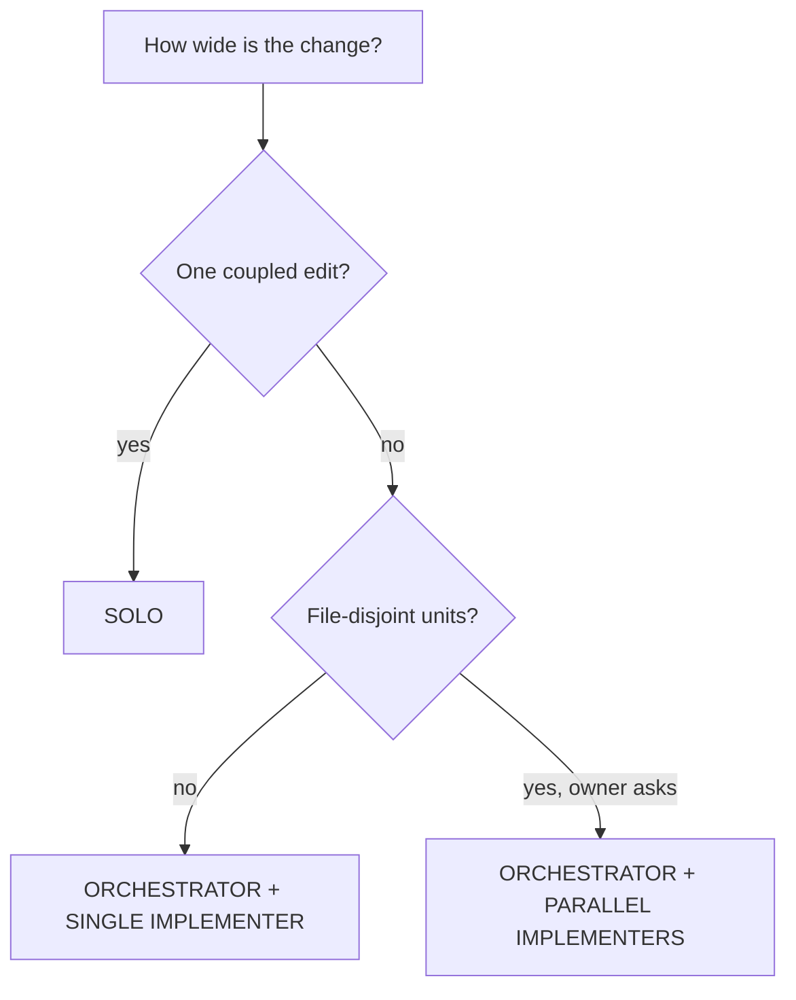

# Choose a workflow

Source of truth: [execution workflows](../../references/execution-workflows.md).

Say the phrase that matches the shape of the work. The glossary owns the words. This page only helps you pick.

Say `SOLO` for one tightly coupled change. Say `work as orchestrator` for the default single implementer. Add `parallelize` only when the owner wants file-disjoint units.

## Next steps

- [Keywords glossary](../reference/keywords.md)
- [How ChaosEngine thinks](../explanation/how-chaosengine-thinks.md)
