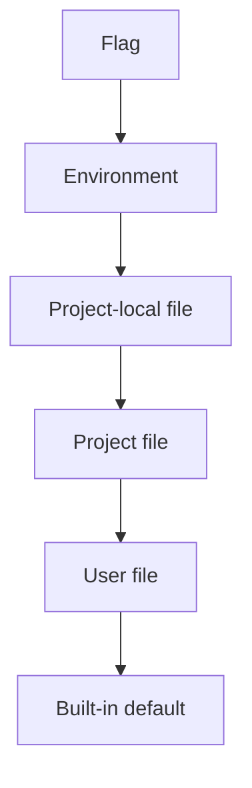

# Configure ChaosEngine

Precedence is the flag, then the environment, then the project-local file, then the project file, then the user file, then the built-in default.

Lists replace the lower level except the keys that union. The generated [settings reference](../reference/settings.md) names every key.

## Next steps

- [Opt in or out](opt-in-or-out.md)
- [Settings reference](../reference/settings.md)
