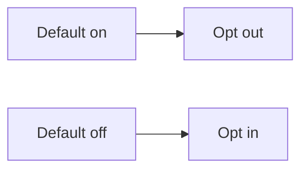

# Opt in or out

A bool whose default is on is an opt-out. A bool whose default is off is an opt-in. The settings reference lists the flag, the env var, and the TOML key.

Say `stop caveman` or `stop ponytail` to drop a companion for this session. `normal mode` drops both. Those phrases are in the [keywords glossary](../reference/keywords.md).

## Next steps

- [Configure](configure.md)
- [Keywords glossary](../reference/keywords.md)
