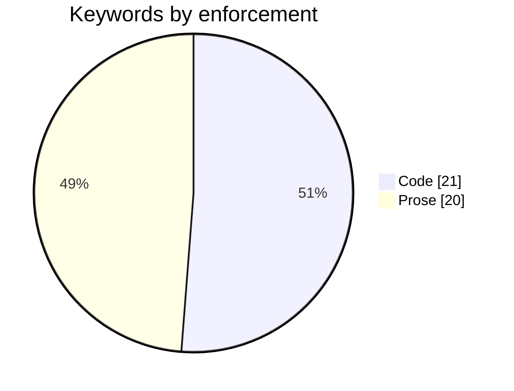

# Keywords glossary

Generated from `references/keywords.json`. One line says what the word does. The linked file owns the rule.

Code means a hook or parser matches the phrase. Prose means only the linked instructions define it.

## Phrases you can say

| Keyword | What it does | Enforced by | Example | Source |
| --- | --- | --- | --- | --- |
| `--allow-cloud` | Allows the OmniRoute cloud transport when the owner says so. | prose | --allow-cloud | [owner](../../references/execution-workflows.md#L1) |
| `babysit and merge it when green` | Selects the watch, fix, and confirm pull-request workflow. | prose | babysit and merge it when green | [owner](../../references/work-github-playbook.md#L1) |
| `delegate` | Selects a writer. The receipt is required before the writer call. See the router. | code | delegate | [owner](../../hooks/delegation_gate.py#L1) |
| `deliver`, `babysit`, `keep the work going` | Keep going until the in-scope work is merged or a named HALT. | prose | deliver | [owner](../../references/orchestrator-follow-through.md#L1) |
| `do not merge` | Counts as out of scope from the owner, not inside a delegated brief. | code | do not merge | [owner](../../hooks/guard.py#L209) |
| `ICM this` | Routes to the advisory ICM workspace architect. | prose | ICM this | [owner](../../runtime/harness_index.py#L161) |
| `normal mode` | Turns off both companion cards for this session. | code | normal mode | [owner](../../hooks/lifecycle.py#L229) |
| `out of scope`, `do not watch`, `do not babysit`, `don't watch` | Marks a named pull request out of scope for babysit. | code | out of scope | [owner](../../hooks/guard.py#L207) |
| `proceed unattended`, `follow up every` | Enables adaptive follow-up by the process owner. | prose | proceed unattended | [owner](../../references/process-owner-scrum-master.md#L1) |
| `explicit status request` | Forces a fresh poll of every registered agent. | prose | explicit status request | [owner](../../references/delegation-cycle.md#L1) |
| `stop caveman` | Turns off the Caveman card for this session. | code | stop caveman | [owner](../../hooks/lifecycle.py#L232) |
| `stop ponytail` | Turns off the Ponytail card for this session. | code | stop ponytail | [owner](../../hooks/lifecycle.py#L234) |
| `supersede` | Open one replacing pull request per the kanban rule. | prose | supersede | [owner](../../skills/kanban/SKILL.md#L1) |
| `tool.py entry` | Hookless bots pass a stop phrase to entry to drop companions. | code | tool.py entry stop caveman | [owner](../../tool.py#L646) |
| `work as orchestrator`, `parallelize` | Selects orchestrated mode. With parallelize, selects parallel implementers. | prose | work as orchestrator | [owner](../../references/execution-workflows.md#L1) |

## Roles and workflows

| Keyword | What it does | Enforced by | Example | Source |
| --- | --- | --- | --- | --- |
| `ORCHESTRATOR + PARALLEL IMPLEMENTERS` | Owner opt-in for file-disjoint units in isolated worktrees. | prose | ORCHESTRATOR + PARALLEL IMPLEMENTERS | [owner](../../references/execution-workflows.md#L1) |
| `ORCHESTRATOR + SINGLE IMPLEMENTER` | Default orchestrated mode. The orchestrator does not implement. | prose | ORCHESTRATOR + SINGLE IMPLEMENTER | [owner](../../references/execution-workflows.md#L1) |
| `process-owner`, `Scrum-master`, `product owner` | Scrum-master only when asked. Product owner maps to process-owner. | prose | process-owner | [owner](../../references/roles.md#L1) |
| `implementer` | Implements one bounded specification before consolidated validation. | code | implementer | [owner](../../hooks/kernel.py#L25) |
| `mechanical-helper` | Deterministic reversible spec-exact work. Stops on ambiguity. | code | mechanical-helper | [owner](../../hooks/kernel.py#L28) |
| `orchestrator` | Plans, synthesizes, and verifies. Does not implement the spec. | code | work as orchestrator | [owner](../../hooks/kernel.py#L24) |
| `reviewer` | Independent read-only adversarial review. Never edits. | code | reviewer | [owner](../../hooks/kernel.py#L26) |
| `tester` | Reproduces behavior and records regression evidence. | code | tester | [owner](../../hooks/kernel.py#L27) |
| `SOLO` | One tightly coupled change. Record rung=direct. | prose | SOLO | [owner](../../references/execution-workflows.md#L1) |

## Modes

| Keyword | What it does | Enforced by | Example | Source |
| --- | --- | --- | --- | --- |
| `radio silence`, `CHAOS_RADIO_SILENCE` | Blocks owner-visible status and routes status to the orchestrator. | code | radio silence | [owner](../../runtime/radio_silence.py#L7) |
| `one file`, `one module`, `public contract`, `ultra-lean`, `lean`, `ultra_lean`, `balanced`, `default`, `deep` | Triage depth selects a plan size and a token-budget mode. | code | one file | [owner](../../hooks/lifecycle.py#L38) |

## Markers and tokens agents write

| Keyword | What it does | Enforced by | Example | Source |
| --- | --- | --- | --- | --- |
| `CE_BRIEF_LOCATORS:` | Closing line that lists verbatim brief paths for a local design turn. | code | CE_BRIEF_LOCATORS: | [owner](../../skills/local-agency/scripts/design_turn_gate.py#L11) |
| `ce_load: required` | A local worker brief must carry this line so the worker loads ChaosEngine. | code | ce_load: required | [owner](../../skills/local-agency/scripts/worker_ce_entry.py#L24) |
| `delegate card` | Short card a dispatched worker loads instead of the router. | prose | delegate card | [owner](../../references/delegate-card.md#L1) |
| `chaos-engine:agentic`, `## Plan` | Marks an agentic pull request. Gates require a plan and a retrieve line. | code | chaos-engine:agentic | [owner](../../hooks/guard.py#L661) |
| `rung=free`, `rung=ask`, `rung=paid`, `rung=direct`, `free=unreachable-declined`, `free=too-complex`, `effort=` | Delegation receipt fields checked by the gate. | code | rung=direct | [owner](../../hooks/delegation_gate.py#L1) |
| `retrieve: used`, `retrieve: skipped`, `retrieve: exempt(harness)` | Required record of the retrieve-first step. | code | retrieve: exempt(harness) | [owner](../../hooks/guard.py#L1) |
| `review_cap`, `review cap` | Two adversarial reviews per subject unless an owner lifts the cap. | code | review cap | [owner](../../hooks/delegation_gate.py#L23) |

## Status words

| Keyword | What it does | Enforced by | Example | Source |
| --- | --- | --- | --- | --- |
| `blocking: unverifiable` | The only allowed stop while a required check is still pending. | prose | blocking: unverifiable | [owner](../../skills/chaos-engine/SKILL.md#check-and-deliver) |
| `Done` | Say Done only after the pre-done self-review sign-off. | prose | Done | [owner](../../skills/pre-done-self-review/SKILL.md#L1) |
| `HALT` | Named stop that ends deliver or babysit. | prose | HALT | [owner](../../references/orchestrator-follow-through.md#L1) |
| `NEEDS-HUMAN` | Human-only blocker routed to the orchestrator contact. | prose | NEEDS-HUMAN | [owner](../../references/sequential-wip.md#L1) |

## Principles and rituals

| Keyword | What it does | Enforced by | Example | Source |
| --- | --- | --- | --- | --- |
| `Learning Session`, `learning session` | Required after every final delivery. | code | Learning Session | [owner](../../hooks/guard.py#L187) |
| `PDCA cap`, `self-accept push` | At most three Plan-Do-Check-Act iterations. Review 1 starts with the self-accept push. | prose | PDCA cap | [owner](../../references/delivery-cycle.md#L1) |
| `person-only attestation` | The agent will not sit an exam or feed live answers. | prose | person-only attestation | [owner](../../companions/ethics-card.md#L1) |
| `step back`, `push back` | After two failed attempts, re-plan. Push back on a risky pick. | prose | step back | [owner](../../identity.md#principles) |

## Routes

Loaded from `runtime/harness_index.py`. This table does not copy the router rule text.

| Route | Use when | Source |
| --- | --- | --- |
| Zero-LLM first | Use when install, doctor, or repair can run as a script before any host chat. Prefer these deterministic paths. | [owner](../../references/zero-llm-catalog.md#L1) |
| Heal | Use when a drifted install, wiped runtime, or unhealthy doctor must be repaired by file path. | [owner](../../references/heal-route.md#L1) |
| Level-1 catalog | Use when a task needs a secondary skill or tool beyond the core router. The list stays short and sorted. | [owner](../../references/level-1-catalog.md#L1) |
| Context firewall | Use when research or a multi-file explore should run in an isolated subagent so the parent stays small. | [owner](../../references/context-firewall.md#L1) |
| harness-learn | Use when repeated session traces show the git-tracked overlay should change; tune the harness in the repo, never under a user-home skill directory (`~/.grok/skills` is one host example). | [owner](../../references/harness-learn.md#L1) |
| design-loop | Use when a design document needs write-review-revise rounds until zero open review issues remain. | [owner](../../references/design-loop.md#L1) |
| deep-research | Use when a question needs bounded parallel research with verification and a cited final report. | [owner](../../references/deep-research.md#L1) |
| ui-delivery | Use when a change touches user-visible UI, layout, styling, or themes: red-then-green e2e, measured geometry, viewport x theme matrix. | [owner](../../references/ui-delivery.md#L1) |
| public-landing | Use when a public calling card or product landing page must convince a human, rank in search, and orient an agent without becoming a second policy. | [owner](../../references/public-landing.md#L1) |
| learn-traces | Use when session traces must be mapped, reduced, and verified into lessons without a host TUI runner. | [owner](../../references/learn-traces.md#L1) |
| Meta-optimize | Use when a periodic offline review of shared logs is due. This is not a continuous session hook. | [owner](../../references/meta-optimize.md#L1) |
| Draft skill PR | Use when an opt-in eval-gated draft skill pull request is requested. The default is off. | [owner](../../references/draft-skill-pr.md#L1) |
| Token budget | Use when triage or the environment selects an ultra-lean, balanced, or deep token budget. | [owner](../../references/token-budget-modes.md#L1) |
| Eliminate waste | Use when a hop, retry, or duplicate tool does not change the next decision and should be dropped. | [owner](../../references/eliminate-waste.md#L1) |
| Prefer CLI over MCP | Use when CLI and MCP both fit the same job; prefer the CLI, and gh when it is configured. | [owner](../../references/prefer-cli-over-mcp.md#L1) |
| No proxy | Use when a task would install, pin, or wrap a traffic proxy. Never install one. | [owner](../../references/no-proxy.md#L1) |
| GAP-EXIT2 UX | Use when Grok, Copilot, Cursor, or OpenCode may not honor an exit-2 hard block and the compensating checklist applies. | [owner](../../references/host-parity-matrix.md#L1) |
| Add-ons | Use when a task fits an optional add-on (design, video, or a project pack): list, install, remove, or load one. | [owner](../../references/addons.md#L1) |
| Complexity gate | Use when a hot-spot dispatch change must treat a static-analysis Complexity ACTION_REQUIRED as a unit failure. | [owner](../../references/complexity-gate.md#L1) |
| Durable jobs | Use when work runs longer than a few minutes and must survive the agent session being killed, with no duplicate workers. | [owner](../../references/durable-jobs.md#L1) |
| Docs follow the change | Use when a change alters a command, flag, default, or other reader-facing contract, including work already done in the session. | [owner](../../references/docs-follow-change.md#L1) |

Role ids: orchestrator, implementer, reviewer, tester, mechanical-helper.
