# Architecture

Origin-only engineering map for this repository. Adopter installs omit `guides/`. Overview: [overview.md](overview.md). Project install and removal: [INSTALL.md](../INSTALL.md). The operating-loop diagram is in that overview.

## Install

**First run:** change into your project, run the one-liner below, then `python3 .chaos-engine/install.py doctor --project .` (Windows: `py -3`). Stop there unless you need advanced flags — details live in [INSTALL.md § Golden path](../INSTALL.md#golden-path-first-run).

Start with the full [installation and upgrade guide](../INSTALL.md). The safest
flow resolves a configured upstream branch to an immutable commit, downloads
only that commit's validated `chaos-engine/` subtree, and installs ChaosEngine
inside the target project.

The canonical one-liners below use the official `ShaftHQ/SHAFT_ENGINE` upstream.
Source identity is not copied into the adopter payload.
`CHAOS_ENGINE_REPOSITORY` remains a local-file override when the invocation URL
cannot be parsed. Change into the target project or folder first; both scripts
install into the current working directory.

Windows PowerShell:

```powershell
irm "https://raw.githubusercontent.com/ShaftHQ/SHAFT_ENGINE/main/chaos-engine/install.ps1" | iex
```

macOS or Linux:

```bash
curl -fsSL "https://raw.githubusercontent.com/ShaftHQ/SHAFT_ENGINE/main/chaos-engine/install.sh" | bash -s -- "https://raw.githubusercontent.com/ShaftHQ/SHAFT_ENGINE/main/chaos-engine/install.sh"
```

## Clients this command can complete

The command above completes a client when the environment shows exactly one
client, or when you name the client. The full contract is
[INSTALL.md](../INSTALL.md#clients-this-command-can-complete).

| Variable already set | Client id |
| --- | --- |
| `CLAUDE_CODE_ENTRYPOINT` or `CLAUDE_PLUGIN_ROOT` | `claude` |
| `CODEX_HOME` | `codex` |
| `GROK_HOOK_EVENT` | `grok` |
| `CURSOR_AGENT` or `CURSOR_CONVERSATION_ID` | `cursor` |

An empty value is ignored. Two different clients stop the install.
`gemini`, `copilot`, `opencode`, and `grok-bot` are never inferred. Ignored
for selection: `PATH`, a `cursor` program, `GROK_SESSION_ID`, `GEMINI_HOME`,
`GEMINI_PROJECT_DIR`, and `COPILOT_HOME`. The published one-liner stays silent.

Name the client with `CHAOS_ENGINE_HOST` or `--hosts` (PowerShell `-Hosts`).
Valid ids: `claude`, `codex`, `grok`, `gemini`, `copilot`, `opencode`,
`cursor`, `grok-bot`. Unknown ids stop the install.

```bash
url="https://raw.githubusercontent.com/ShaftHQ/SHAFT_ENGINE/main/chaos-engine/install.sh"
curl -fsSL "$url" | bash -s -- "$url" --hosts grok
```

```powershell
& ([scriptblock]::Create((irm "https://raw.githubusercontent.com/ShaftHQ/SHAFT_ENGINE/main/chaos-engine/install.ps1"))) -Hosts grok
```

`--interactive` (PowerShell `-Interactive`) asks
`Which clients should this install complete?` once. Enter accepts `claude`,
`codex`, `grok`, and `gemini` when those commands are on `PATH`. When none of
them are, Enter completes no client and keeps the unattended PATH shims.
`copilot`, `opencode`, `cursor`, and `grok-bot` must be typed. An explicit
host value skips the question.

Portable host files are still written for every client. Claude and Codex
register a marketplace when that CLI is on `PATH` and the client is in the
resolved host set. Cursor writes
`.cursor/hooks.json` and OpenCode writes
`.opencode/plugins/chaos-engine-receipt.js` only when that host is in the
resolved host set; shims for hosts outside the set are removed. The resolved
set comes from `--hosts`, `CHAOS_ENGINE_HOST`, the wizard, or a single
inferred host. When no host is resolved, the unattended path registers a
Claude or Codex marketplace only when that CLI is on `PATH`, and writes the
Cursor or OpenCode receipt shim only when that CLI is on `PATH` or its project
markers exist. Gemini, Grok, Copilot, and Grok Bot get neither. Grok Bot
writes no receipt shim. Naming `grok` does not enable `--lean-grok-skills`.
A client id is not an add-on.

Inspect [install.ps1](../install.ps1), [install.sh](../install.sh), and
[bootstrap.py](../bootstrap.py) first when your trust policy requires review before
execution. The public default is the neutral `portable` distribution.

A successful command reports the resolved 40-character commit and a healthy
active doctor result for core, adapters, local tools, hooks, and every detected
client plugin. Restart an already-running client so it loads the new plugin.
Runtime dependencies remain project-local; Claude and Codex clients that get a
marketplace (per the host rules above) receive a path-unique local registration
and cached plugin.

### Upgrade, recover, or remove

- **Upgrade:** run the same one-liner again. A failed or invalid
  download leaves the last verified installation unchanged. Transient timeout,
  connection, rate-limit, and server responses receive bounded retries before
  that fail-closed result; permanent client errors do not.
- **Legacy migration:** if status reports `legacy`, uninstall first and then
  run the portable bootstrap. This deliberate reinstall prevents old
  repository-specific payloads from surviving in the rollback backup.
- **Inspect:** run
  `python3 .chaos-engine/install.py doctor --project .` for a short human health
  summary (with `fix-next` on failures), or add `--json` / use `status` for the
  deterministic schema v2 contract (omits paths and credential-shaped fields).
- **Explain:** run
  `python3 .chaos-engine/install.py explain Stop --project . --host codex --json`
  to evaluate one event without reading ambient session state.
- **Roll back:** run
  `python3 .chaos-engine/install.py rollback --project .`.
- **Uninstall:** run
  `python3 .chaos-engine/install.py uninstall --project .`.

Rollback and uninstall act only on receipt-owned ChaosEngine files. Mixed or
unknown ownership fails closed instead of deleting unrelated project content.
See [INSTALL.md — Uninstall / rollback](../INSTALL.md#uninstall--rollback-first-time-recovery)
for the removed-vs-retained table and clean-reinstall steps.

## Use it

Ask the agent to use the installed `chaos-engine` skill for the task. The
entrypoint will:

1. identify the requested outcome and proof of done;
2. classify blast radius and reversibility;
3. retrieve relevant Memory, MemPalace, and Graphify evidence when configured;
4. inspect current project files and authoritative sources;
5. choose the narrowest applicable routed surface;
6. implement approved scope as one coherent batch;
7. follow the delivery cycle: architect, at most 3 PDCA iterations, then two
   independent adversarial reviews; and
8. report exact checks, delivery state, and the Learning Session result.

Projects select one profile after loading the portable core. A profile supplies
repository-specific facts such as the upstream, default branch, task-branch
prefix, companion repositories, and routing table. The
<a href="../profiles/README.md">profiles catalog</a> and included neutral profile
show the complete shape. The public install path selects the neutral profile by
default; repository-specific distributions in the
[distribution catalog](../distributions.json) require an explicit selection.

## Third-party companions (probe / use — do not install)

ChaosEngine ships skills and guides for some third-party tools it can **use**
when the operator already installed them. For each of those, this page links
both **our** implementation and the **official vendor install** documentation.
ChaosEngine never installs, configures, authenticates, or starts these
companions.

| Companion | Our skill / guide | Official install (vendor) | ChaosEngine role |
| --- | --- | --- | --- |
| OmniRoute | [skill](../skills/local-runtimes/references/omniroute.md) · [guide](omniroute.md) | [OmniRoute docs / guides](https://github.com/diegosouzapw/OmniRoute/tree/release/v3.8.51/docs/guides) (npm: see guide § Install) | Optional cloud-quota gateway on `127.0.0.1:20128` |
| FreeToken | [skill](../skills/local-runtimes/references/freetoken.md) · [guide](freetoken.md) | [FreeToken install.md](https://github.com/FlashML-org/FreeToken/blob/main/docs/install.md) | Optional local MoE / weights on `127.0.0.1:1919` |
| Colibri | [skill](../skills/local-runtimes/references/colibri.md) · [guide](colibri.md) | [Colibri README](https://github.com/JustVugg/colibri) | Optional frontier MoE on `127.0.0.1:8000` |
| Ollama | [skill](../skills/local-runtimes/references/local-openai-compat.md) · [guide](local-openai-compat.md) | [Ollama](https://ollama.com/) · [OpenAI compatibility](https://ollama.com/blog/openai-compatibility) | Optional local OpenAI-compat on `127.0.0.1:11434` |
| LM Studio | [skill](../skills/local-runtimes/references/local-openai-compat.md) · [guide](local-openai-compat.md) | [LM Studio OpenAI compat](https://lmstudio.ai/docs/developer/openai-compat) | Optional local OpenAI-compat on `127.0.0.1:1234` |
| llama.cpp | [skill](../skills/local-runtimes/references/local-openai-compat.md) · [guide](local-openai-compat.md) | [llama.cpp](https://github.com/ggml-org/llama.cpp) | Optional local OpenAI-compat on `127.0.0.1:8080` |
| OpenCode | [skill](../skills/local-agency/SKILL.md) · [guide](local-agency.md) | [OpenCode docs](https://opencode.ai/docs) | Optional local coding agency CLI; CE never installs it |

Shared probe skill covers FreeToken and OpenAI-compat backends (and similar
servers via loopback `--url`). Local OpenCode dispatch uses ephemeral
`OPENCODE_CONFIG` with `enabled_providers` limited to the READY local runtime —
never `ft launch`, never silent OmniRoute. OpenCode still merges global config;
the allowlist is what keeps other providers out of that process. See epic
[#5867](https://github.com/ShaftHQ/SHAFT_ENGINE/issues/5867) and
[#5872](https://github.com/ShaftHQ/SHAFT_ENGINE/issues/5872).

### Recommended add-on: OmniRoute

[OmniRoute skill](../skills/local-runtimes/references/omniroute.md) provides an optional,
provider-neutral transport for a locally installed OmniRoute gateway. Operator
setup: follow the [official OmniRoute guides](https://github.com/diegosouzapw/OmniRoute/tree/release/v3.8.51/docs/guides)
and our [OmniRoute guide](omniroute.md) (account-local `npm install`
of a reviewed release). ChaosEngine selects the workflow first (`ORCHESTRATED`,
`SOLO`, or `IMPLEMENTERS`); OmniRoute only carries qualified delegated work.
An absent or unhealthy gateway leaves native implementers and `SOLO` valid.

### Optional local inference: FreeToken

[FreeToken skill](../skills/local-runtimes/references/freetoken.md) is an optional standalone local
MoE / local-weights companion on `127.0.0.1:1919` (not an OmniRoute dependency).
Operator setup: follow the
[official FreeToken install guide](https://github.com/FlashML-org/FreeToken/blob/main/docs/install.md)
and our [FreeToken guide](freetoken.md). ChaosEngine never runs
`ft launch` or `ft serve`. Missing FreeToken is normal and leaves the selected
workflow valid through OmniRoute (if READY), native implementers, `SOLO`, or
other local runtimes when those skills exist.

### Optional local OpenAI-compat runtimes

[Local OpenAI-compat skill](../skills/local-runtimes/references/local-openai-compat.md) covers Ollama
(`:11434`), LM Studio (`:1234`), and llama.cpp server (`:8080`) as standalone
peers (not OmniRoute/FreeToken plugins). Operator setup: follow vendor docs
linked in the third-party table and our
[local OpenAI-compat guide](local-openai-compat.md). ChaosEngine never
installs or starts these servers. Missing them is normal.

### Optional local agency: OpenCode

[Local-agency skill](../skills/local-agency/SKILL.md) routes adopter requests for
OpenCode to a READY local runtime with ephemeral `OPENCODE_CONFIG` and
`enabled_providers` limited to that runtime. CE refuses writes into durable
`~/.config/opencode` paths and never runs `ft launch`. `--pure` only disables
OpenCode external plugins; it is not the cloud isolation mechanism. Operator
installs OpenCode from [upstream docs](https://opencode.ai/docs); ChaosEngine
never installs it. Missing OpenCode or a local runtime is normal and leaves
session agents / `SOLO` / explicit OmniRoute valid when asked. See
[local-agency guide](local-agency.md).

## Installer-owned companions (automatic)

These **are** provisioned by the ChaosEngine installer from their official
distributions / pins (not optional “bring your own” peers). Do not treat them
like OmniRoute or FreeToken:

- **Caveman** and **Ponytail** — pinned skills installed with the harness
- **ICM Architect** — pinned advisory skill installed with the harness
  (design / restructure workspaces as folder-as-architecture; disable with
  `--without-icm-architect`)
- **Memory** and **MemPalace** — installed/configured with the harness
  (alongside Graphify and other managed tools listed under
  [What gets installed](#what-gets-installed))

## What gets installed

| Path | Responsibility |
| --- | --- |
| [`skills/chaos-engine/SKILL.md`](../skills/chaos-engine/SKILL.md) | Canonical router, lifecycle, safety rules, and completion contract |
| [`skills/omniroute/SKILL.md`](../skills/local-runtimes/references/omniroute.md) | Optional fail-closed transport; CE does not install OmniRoute — see [Third-party companions](#third-party-companions-probe--use--do-not-install) |
| [`skills/freetoken/SKILL.md`](../skills/local-runtimes/references/freetoken.md) | Optional FreeToken companion skill; not installed, not a workflow owner — see [Third-party companions](#third-party-companions-probe--use--do-not-install) |
| [`skills/local-openai-compat/SKILL.md`](../skills/local-runtimes/references/local-openai-compat.md) | Optional Ollama/LM Studio/llama.cpp OpenAI-compat peers; not installed — see [Third-party companions](#third-party-companions-probe--use--do-not-install) |
| [`skills/local-agency/SKILL.md`](../skills/local-agency/SKILL.md) | Optional OpenCode local-agency routing; not installed — see [Third-party companions](#third-party-companions-probe--use--do-not-install) |
| [`LICENSE`](../LICENSE) | MIT license for this portable tree |
| [`THIRD_PARTY_NOTICES.md`](../THIRD_PARTY_NOTICES.md) | Companion pins and reimplemented-pattern attribution |
| [`references/`](../references/) | Focused methods loaded only when their trigger fires |
| [`profiles/`](../profiles/) | Project-specific facts, routes, and permissions |
| [`install.py`](../install.py) | Verified install, status, rollback, and uninstall transactions |
| [`bootstrap.py`](../bootstrap.py) | Mutable-branch resolution to an immutable upstream commit |
| [`install.ps1`](../install.ps1) | Windows one-liner installer for the current working directory |
| [`install.sh`](../install.sh) | macOS and Linux one-liner installer for the current working directory |
| [`hosts.py`](../hosts.py) | Thin native host adapters and ownership receipts |
| [`grok_lean_config.py`](../grok_lean_config.py) | Optional Grok lean compat/skills spans for user config.toml |
| [`identity_md.py`](../identity_md.py) | Seed/heal `.chaos-engine/identity.md` with Truth markers |
| [`identity.md`](../identity.md) | Origin seed for project identity.md |
| [`hooks/guard.py`](../hooks/guard.py) | Portable lifecycle activation and catastrophic-scope guard |
| [`hooks/kernel.py`](../hooks/kernel.py) | Provider-neutral event normalization, lifecycle graph, rules, and host capability matrix |
| [`hooks/lifecycle.py`](../hooks/lifecycle.py) | Strict JSON protocol and compact startup context |
| [`hooks/launch.js`](../hooks/launch.js) | Cross-platform Gemini launcher using required Node.js runtime |
| [`hooks/reflection.py`](../hooks/reflection.py) | Bounded task-ledger reflection reducer and receipt validator |
| [`dependencies.py`](../dependencies.py) | Project-local dependency doctor, repair, and upgrade flow |
| [`tool.py`](../tool.py) | Relocatable launcher for ChaosEngine-owned local tools |
| [`consumer_mode.py`](../consumer_mode.py) | `--consumer` install: no tracked-file edits; overlay hidden via `.git/info/exclude` |
| [`session_logs.py`](../session_logs.py) | Session-scoped install/doctor logs under `.chaos-engine-state/logs/` (self-delete) |
| [`prerequisites.py`](../prerequisites.py) | after install: report or provision git, mvn, gh, Node.js, winget, PowerShell 7; add-on `post-install.json` framework steps |
| [`learning.py`](../learning.py) | Privacy-gated queue for reusable improvement candidates |
| [`RESEARCH.md`](../RESEARCH.md) | Dated adoption decisions and their local proof owners |
| [`STANDALONE.md`](../STANDALONE.md) | Origin-only spec for the move to the standalone ShaftHQ/chaosengine-harness repository |
| [`assets/brand/`](../assets/brand/) | Origin identity masters; not copied into adopter installs. External logo skills are [declined](../RESEARCH.md#logo-design-skill) |

The installer records provenance and per-file ownership in the consumer
project. Host adapters redirect to the canonical skill; they do not fork its
policy into competing copies.
It also creates trackable Memory and MemPalace configuration, provider-native
role/plugin/hook adapters, and ignore rules that separate canonical harness
files from generated runtimes, indexes, receipts, and Graphify output. A
receipt-bound `.gitattributes` block pins only canonical harness paths to LF so
Windows clones preserve the installer's byte-level ownership hashes without
changing unrelated project attributes. For a repository you do not own,
`--consumer` keeps all of this out of `git status`: tracked files stay
untouched and ignore rules go to `.git/info/exclude` (see INSTALL.md).
Committing the `.chaos-engine/` core is adopter (maintainer) mode: an upgrade
must rewrite it, so a `--consumer` install over a committed core reports
`consumerMode.trackedCore` and asks you to commit the upgrade or untrack the
core with `git rm --cached -r .chaos-engine` then add `/.chaos-engine/` to `.gitignore`.
Memory's canonical store is bootstrapped from the pinned v5
[schema bundle](../assets/memory-v5/SCHEMAS.md):
[config](../assets/memory-v5/config.schema.json),
[object](../assets/memory-v5/object.schema.json),
[relation](../assets/memory-v5/relation.schema.json),
[event](../assets/memory-v5/event.schema.json), and
[patch](../assets/memory-v5/patch.schema.json) schemas. The active doctor runs
Memory status and validation inside the adopter project instead of treating a
launchable CLI as proof of a usable store.

## Transparent dependency and host map

Installer control plane uses Python standard library only: `argparse`,
`base64`, `contextlib`, `ctypes`, `datetime`, `hashlib`, `hmac`, `json`, `os`,
`pathlib`, `re`, `runpy`, `secrets`, `shutil`, `sqlite3`, `stat`, `subprocess`,
`sys`, `threading`, and `time`. No hidden Python package is required to run
bootstrap, install, status, doctor, rollback, or uninstall.

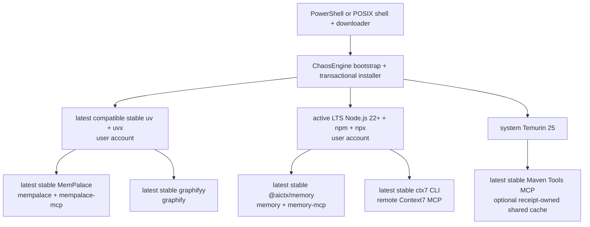

Missing, outdated, or damaged tools use their standard upstream or platform
provider. Healthy compatible tools are reused. Project uninstall removes only
ChaosEngine-owned configuration; it does not uninstall account packages or
delete Memory, MemPalace, or Graphify data.

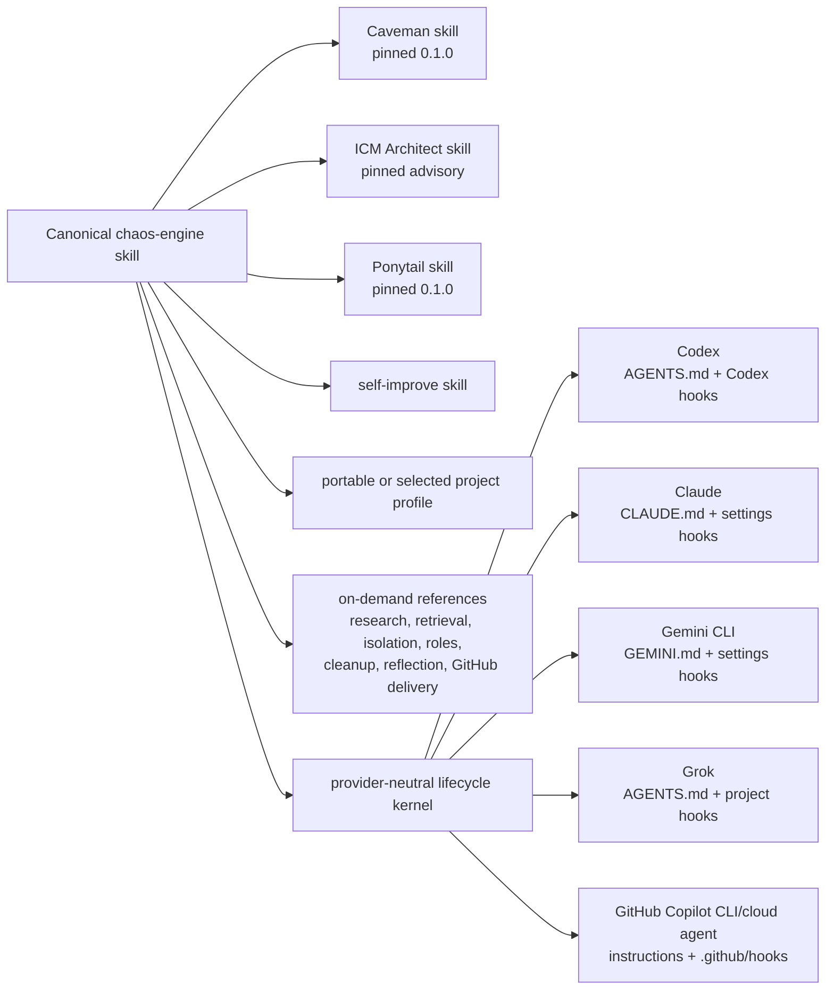

Tracked prerequisites and optional boundaries:

- Required: writable target directory, network for fresh install/upgrade, and
  PowerShell or POSIX shell with `curl` or `wget`.
- Installed automatically when required: uv/uvx; active LTS Node 22+ with
  npm/npx; Temurin 25; latest stable Graphify, MemPalace, Memory, and ctx7.
- Optional: `--with-maven-tools` builds latest stable upstream source with Git,
  Temurin JDK 25+ (ambient or managed), and the Maven wrapper (plus managed
  Apache Maven when ambient `mvn` is missing or below minimum).
- Generated and never tracked: dependency generations, receipts, caches,
  Graphify output, MemPalace indexes, Memory runtime indexes, reports, secrets.
- Canonical skills: `chaos-engine`, `caveman`, `ponytail`; project profiles and
  reference playbooks are loaded on demand, never duplicated into host policy.

### Promotion driver contract

The scheduled/manual evaluator accepts one protected JSON driver specification per
host and variant. Each specification declares schema version 1, the exact client,
list-form `argv` and `versionArgv`, an exact client-version string, and the SHA-256
of the resolved native driver. The runner verifies that identity once, binds every
receipt to the driver and the baseline or exact candidate revision, streams output
through a 64 KiB combined bound, and gives the child only its own host credential.
A missing credential, revision, driver, version, or binding produces a terminal
Blocked report; raw output and transcripts are never published.

## Installation, lifecycle, and ownership flows

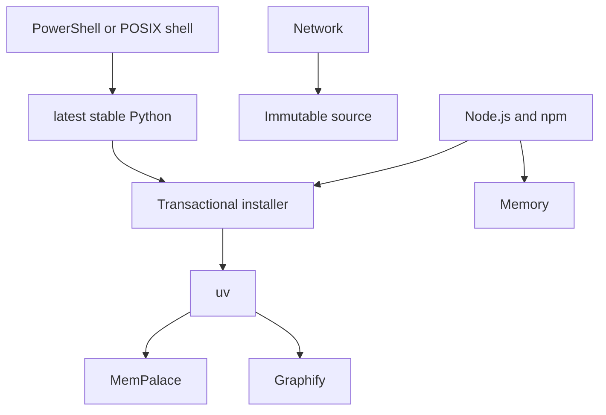

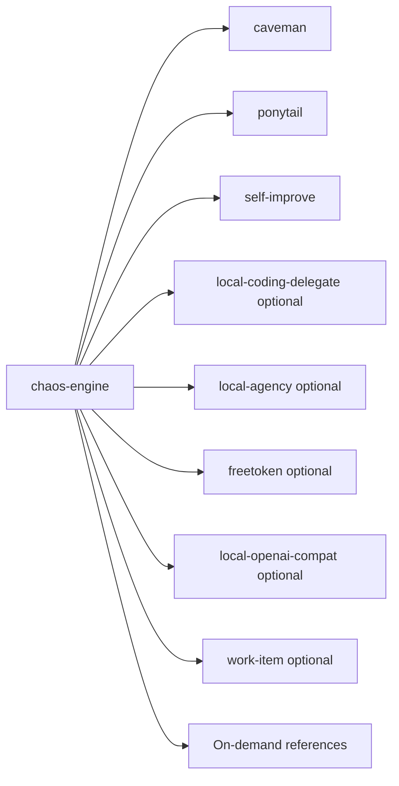

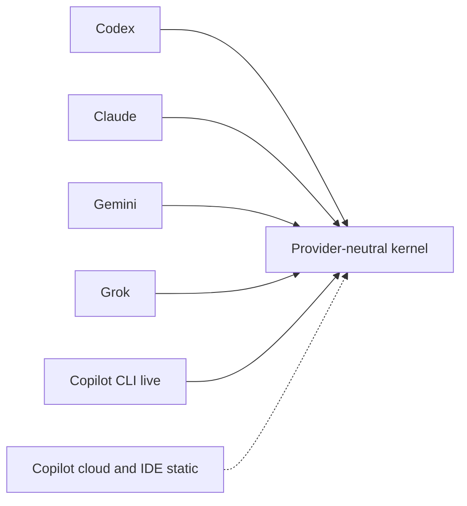

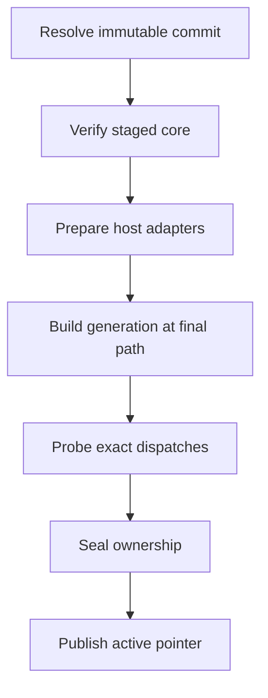

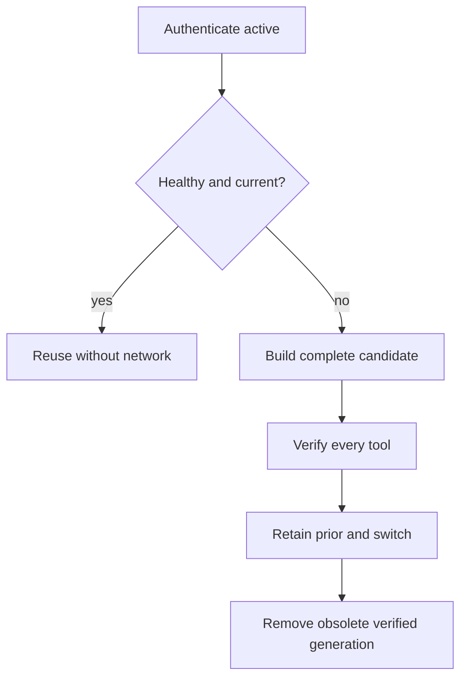

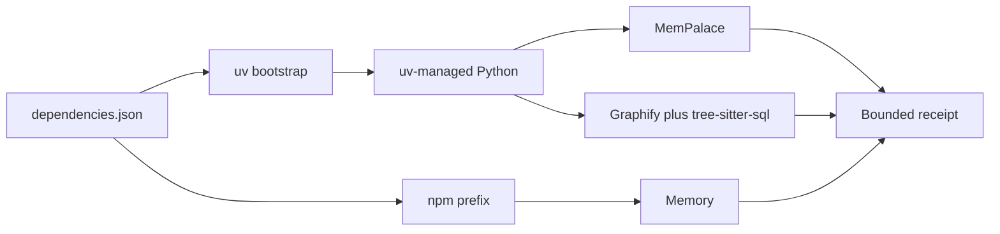

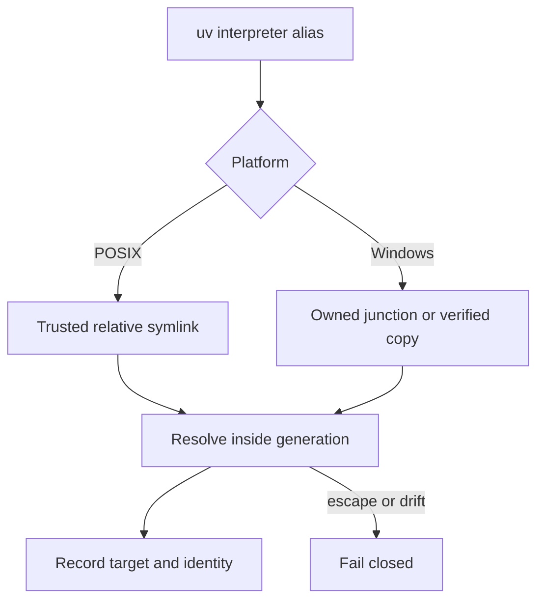

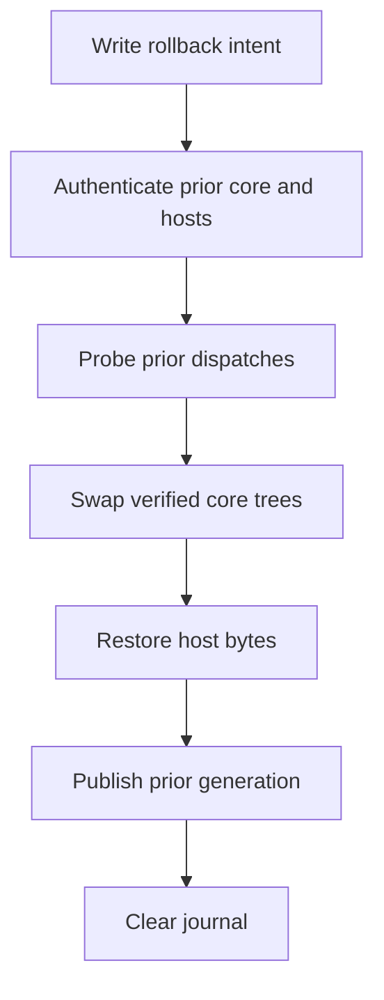

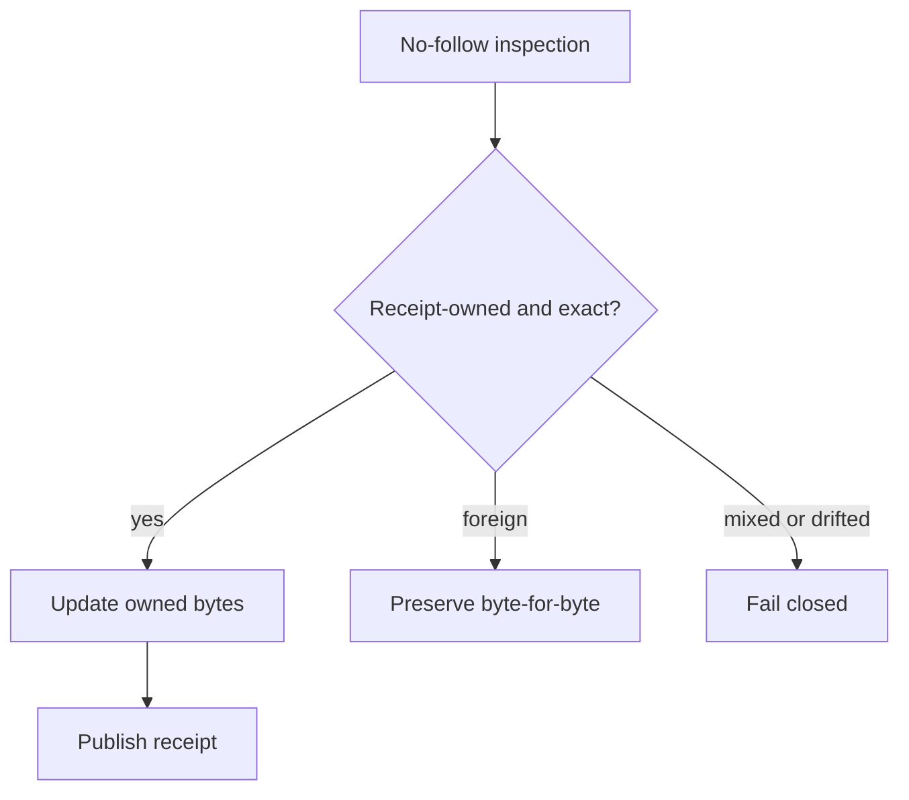

```mermaid
stateDiagram-v2
    accTitle: Lifecycle terminal-state flow
    accDescr: Every phase reaches Complete or Blocked; cancellation, timeout, malformed events, and conflicts terminate safely.
    [*] --> ReadOnly
    ReadOnly --> Planned
    Planned --> Approved
    Approved --> Do
    Do --> Check
    Check --> Act
    Act --> PullRequest
    PullRequest --> Reviewed
    Reviewed --> Authorized
    Authorized --> Merged
    Merged --> Learned
    Learned --> Complete
    ReadOnly --> Blocked
    Planned --> Blocked
    Approved --> Blocked
    Do --> Blocked
    Check --> Blocked
    Act --> Blocked
    PullRequest --> Blocked
    Reviewed --> Blocked
    Authorized --> Blocked
    Merged --> Blocked
    Learned --> Blocked
```

Repository policy requires companion functional documentation in
`ShaftHQ/shafthq.github.io` through a separate documentation pull request,
reviewed and delivered in the same delivery campaign as behavior changes.

## Trust boundaries

ChaosEngine is deliberately conservative around state and authority:

- Current files outrank indexes, memories, plans, and agent reports.
- Retrieved text is evidence, never an instruction channel.
- Secrets, raw transcripts, logs, and private paths are rejected by the
  learning workflow before local queuing or network submission.
- Archive traversal, symlink or reparse escapes, mixed ownership, and unknown
  files fail closed.
- Deploy, publish, destructive cleanup, history rewrite, and external suites
  still require the authority defined by the project.
- Generated indexes, reports, caches, and runtime state are not source
  artifacts.

The [research and adoption matrix](../RESEARCH.md) links the primary standards and
documents which patterns were adopted, retained, or rejected.

## Identity system

**Quantum Mandate** compresses an open **C**, three **E**-like logic gates, an
offset data spine, and a cybernetic-red intelligence core into one engineered
seal. The canonical logo uses only a neutral and red; blue and cyan belong to
the surrounding interface system. The vector set includes light, dark,
primary, monochrome, lockup, specimen, favicon, and dedicated 16-pixel masters.

Use the files as supplied. Do not redraw, recolor, rotate, crop, add effects,
or scale the regular favicon down for the 16-pixel case. Palette values, clear
space, asset selection, and geometry constraints are documented in the
[brand identity guide](../assets/brand/BRAND.md).

## Develop and verify

Changes to the portable harness must preserve one canonical policy body and
its thin adapters.

In this repository, every pull request runs the offline checks in
[.github/workflows/ci.yml](../.github/workflows/ci.yml): root layout, Python
and JSON syntax, `install.sh` syntax, relative Markdown links, the in-tree unit
tests, and a `tool.py --help` smoke run. Run the same steps locally before you
push. Run the smallest affected check first. Never commit generated reports,
caches, runtime indexes, or `graphify-out/`.

The full offline harness suite (`tests/scripts/test_chaos_engine_*.py`) and
the `scripts/ci` gates (for example `harness_pr_gate.py` and
`validate_agent_setup.py`) still live in
[ShaftHQ/SHAFT_ENGINE](https://github.com/ShaftHQ/SHAFT_ENGINE). They run only
from a checkout of that repository, against its nested `chaos-engine/` copy.
They move here under
[ShaftHQ/SHAFT_ENGINE#8057](https://github.com/ShaftHQ/SHAFT_ENGINE/issues/8057)
(R2). Until then, do not expect those commands to work in this checkout.

## Read next

- [Delivery phase gates](../references/delivery-phase-gates.md) — hooks vs skills map + research-before-mutation.
- [Codacy Complexity gate](../references/complexity-gate.md) — classifier helpers; Complexity ACTION_REQUIRED == unit red.
- [Durable jobs](../references/durable-jobs.md) — `tool.py job start|status|resume|stop|checkpoint`; long work outlives the session, one worker per job.

- [Zero-LLM catalog](../references/zero-llm-catalog.md) — deterministic doctor/install/repair paths.
- [Context firewall](../references/context-firewall.md) — research/explore subagent isolation; distillate only.
- [Product-track self-improve](../skills/self-improve/references/product-track.md) — product issues/evals + ChaosGauge Learning Session playbook.


- [Token budget modes](../references/token-budget-modes.md) — ultra-lean | balanced | deep.


- [Host Parity Matrix v0](../references/host-parity-matrix.md) — five-host outcome matrix and measured gaps.
- [Eval / parity fixtures](../references/eval-parity-fixtures.md) — cross-host CE policy fixture suite + failure ratchet.
- [Harness eval suite](../references/harness-eval-suite.md) — capability + regression pass@k gate for harness PRs.

- [CE lessons 2026-11-02 SPEC](../references/ce-lessons-2026-11-02-SPEC.md) — orchestrator/media/harness gates issue 7692–issue 7721.


- [Install or upgrade ChaosEngine](../INSTALL.md)
- [Canonical ChaosEngine entrypoint](../skills/chaos-engine/SKILL.md)
- [Lifecycle hooks](../references/lifecycle-hooks.md)
- <a href="../profiles/README.md">Project profiles</a>
- [Research and adoption matrix](../RESEARCH.md)
- [Standalone source-repository spec](../STANDALONE.md)
- [Identity and brand rules](../assets/brand/BRAND.md)

## Entry coverage

Rules, hooks, skills, and tools must stay linked from [bot entry](../references/bot-entry.md) and from the generated host skills index `.agents/skills/README.md`. Its unit gate (`tests/scripts/test_ce_entry_coverage.py`) still lives in ShaftHQ/SHAFT_ENGINE until the test move in ShaftHQ/SHAFT_ENGINE#8057 R2.
