# ChaosEngine overview

The detail behind the short [README](../README.md): who uses ChaosEngine, what it does, which hosts it supports, how a session runs, and where each concept is documented. Install options are in [INSTALL.md](../INSTALL.md).

## Who it is for

These roles share one contract. Every role loads the same entrypoint.

| Role | What they use the contract for |
| --- | --- |
| Tester | Reproduction, regression, and acceptance evidence before a claim of done. |
| Frontend developer | Interface changes through the same plan, implementation, and review loop. |
| Backend developer | Service, API, and contract changes through that same loop, including callers. |
| Product owner | Scope, priority, and an inspectable delivery state. In orchestrated mode this is the [process-owner](../references/process-owner-scrum-master.md) duty. |
| Scrum master | Flow, WIP, and honest status when the session asks for the scrum-master alias of process-owner. |

Inside a session, agent accountability is a separate choice. The agent roles
are orchestrator, implementer, reviewer, tester, and mechanical-helper. See
[roles](../references/roles.md).

## What it does

- **Evidence over inference.** Read and run the real system before making a
  claim.
- **Research before mutation.** Retrieve prior decisions, inspect current
  callers, and compare viable approaches first.
- **Plan, Do, Check, Act.** After approval, finish the accepted scope as one
  coherent batch. The [delivery cycle](../references/delivery-cycle.md) allows at
  most three PDCA iterations.
- **Adversarial review.** After the accepted Check and green required checks,
  two independent reviews run on that head. The author is neither reviewer.
- **Durable learning.** Reusable facts and decisions go to structured stores.
  Transcripts and private material stay out of policy.

```mermaid
flowchart LR
    accTitle: ChaosEngine delivery loop
    accDescr: A task moves through Plan, Do, Check, Act, delivery, and one durable learning decision without microstep loops.
    T[Task and triage] --> R[Live research]
    R --> P[Plan complete scope]
    P --> D[Do complete implementation]
    D --> F[Final scope commit]
    F --> A[Automated CI and comment fixes]
    A --> X[Two adversarial reviews<br/>after the green head]
    X --> V[Extra local tests]
    V --> G[Merge]
    G --> M[Confirmed merge]
    M --> L[Learning Session]
```

The canonical rules live in
[skills/chaos-engine/SKILL.md](../skills/chaos-engine/SKILL.md). That entrypoint
sizes the task, loads the one relevant routed surface, and keeps detailed
guidance out of the always-loaded context until it is needed.

## Supported hosts

The installer accepts eight host ids (`INSTALL_HOST_IDS` in
[bootstrap.py](../bootstrap.py)). Five have lifecycle hook adapters in
[hooks/kernel.py](../hooks/kernel.py) and [hosts.py](../hosts.py). OpenCode, Cursor,
and Grok Bot are instruction-only. Measured gaps, including exit-2 fidelity,
are in the [host parity matrix](../references/host-parity-matrix.md).

| Id | Host | What this tree implements |
| --- | --- | --- |
| `claude` | Claude Code | Lifecycle hooks. Marketplace registration when `claude` is on `PATH` and the resolved host set includes it (or no host was resolved). |
| `codex` | Codex | Lifecycle hooks. Marketplace registration when `codex` is on `PATH` and the resolved host set includes it (or no host was resolved). |
| `gemini` | Gemini CLI | Lifecycle hooks. The hook launcher is Node.js ([hooks/launch.js](../hooks/launch.js)). |
| `grok` | Grok | Lifecycle hooks. This host can ignore an exit-2 deny (GAP-EXIT2). |
| `copilot` | GitHub Copilot | Lifecycle hooks for the CLI. Cloud and IDE surfaces are checked statically. This host can ignore an exit-2 deny (GAP-EXIT2). |
| `opencode` | OpenCode | Instruction-only (`AGENTS.md`). Writes `.opencode/plugins/chaos-engine-receipt.js` when the resolved host set includes it, or on detection when no host was resolved. |
| `cursor` | Cursor | Instruction-only (`AGENTS.md`). Writes `.cursor/hooks.json` when the resolved host set includes it, or on detection when no host was resolved. No portable pre-tool hook (GAP-CURSOR-HOOKS). |
| `grok-bot` | Grok Bot | Instruction-only. Reads the [bot entry](../references/bot-entry.md) at task start. The installer writes no receipt shim. |

[hosts.py](../hosts.py) also maps `antigravity` to `AGENTS.md`. That id is
outside the installer host list. Independent agents that load nothing from the
checkout use the same bot-entry path as Grok Bot.

When the environment shows exactly one of Claude, Codex, Grok, or Cursor, the
one-liner completes that host. With no inferred host and no `--hosts` or
`CHAOS_ENGINE_HOST` value, it still writes the portable files and keeps the
unattended PATH shims. Naming rules, the silent one-liner, and the wizard are
in [INSTALL.md](../INSTALL.md#clients-this-command-can-complete).

## Use

Ask the agent to use the installed `chaos-engine` skill. The entrypoint will:

1. Identify the requested outcome and the proof of done.
2. Classify blast radius and reversibility.
3. Retrieve Memory, MemPalace, and Graphify evidence when those stores are
   configured.
4. Inspect current project files and authoritative sources.
5. Choose the narrowest routed surface that applies.
6. Implement the approved scope as one coherent batch.
7. Follow the delivery cycle: architect, at most three PDCA iterations, then
   two independent adversarial reviews.
8. Report the exact checks, the delivery state, and the Learning Session
   result.

## Core concepts

| Topic | Document |
| --- | --- |
| Canonical router and completion contract | [skills/chaos-engine/SKILL.md](../skills/chaos-engine/SKILL.md) |
| Delivery cycle | [references/delivery-cycle.md](../references/delivery-cycle.md) |
| Phase gates | [references/delivery-phase-gates.md](../references/delivery-phase-gates.md) |
| Agent roles | [references/roles.md](../references/roles.md) |
| Process owner | [references/process-owner-scrum-master.md](../references/process-owner-scrum-master.md) |
| Delegation | [references/delegation.md](../references/delegation.md) |
| Host parity and measured gaps | [references/host-parity-matrix.md](../references/host-parity-matrix.md) |
| Lifecycle hooks | [references/lifecycle-hooks.md](../references/lifecycle-hooks.md) |
| Skill and route catalog | [references/catalog.md](../references/catalog.md) |
| Harness map | [references/harness-map.md](../references/harness-map.md) |
| Profiles and packs | [profiles/README.md](../profiles/README.md) |
| Bot entry for hookless agents | [references/bot-entry.md](../references/bot-entry.md) |
| Durable jobs | [references/durable-jobs.md](../references/durable-jobs.md) |
| Zero-LLM doctor and repair | [references/zero-llm-catalog.md](../references/zero-llm-catalog.md) |
| Context firewall | [references/context-firewall.md](../references/context-firewall.md) |
| Token budget modes | [references/token-budget-modes.md](../references/token-budget-modes.md) |
| Learning Session | [skills/self-improve/SKILL.md](../skills/self-improve/SKILL.md) |
| Research and adoption record | [RESEARCH.md](../RESEARCH.md) |
| Architecture notes (origin-only) | [guides/architecture.md](../guides/architecture.md) |
| Optional local companions (origin-only) | [OmniRoute](../guides/omniroute.md), [FreeToken](../guides/freetoken.md), [Colibri](../guides/colibri.md), [local agency](../guides/local-agency.md), [OpenAI-compat runtimes](../guides/local-openai-compat.md) |

ChaosEngine probes those local companions when the operator has already
installed them. Install, configuration, authentication, and process start stay
with the operator. Caveman, Ponytail, and ICM Architect are pinned skills the
installer provisions. Memory, MemPalace, and Graphify are provisioned with the
harness. Detail is in the architecture guide.

## Status and roadmap

Tree version: `0.4.20261115.2` ([VERSION](../VERSION)). Notes for that version
are in [CHANGELOG.md](../CHANGELOG.md).

This repository is ShaftHQ/chaosengine-harness. The tree sits at the
repository root. It was extracted from `ShaftHQ/SHAFT_ENGINE` `chaos-engine/`,
and the history was preserved.

- Epic: [ShaftHQ/SHAFT_ENGINE#8056](https://github.com/ShaftHQ/SHAFT_ENGINE/issues/8056)
- Standalone repository spec: [ShaftHQ/SHAFT_ENGINE#8057](https://github.com/ShaftHQ/SHAFT_ENGINE/issues/8057)

Still open on that spec: release publishing, the installer pin and the
redirect from the `ShaftHQ/SHAFT_ENGINE` one-liner, issue transfer, and
role-based docs. This checkout already contains the changelog above and
[.github/workflows/ci.yml](../.github/workflows/ci.yml). Origin-only migration
notes are in [STANDALONE.md](../STANDALONE.md).
