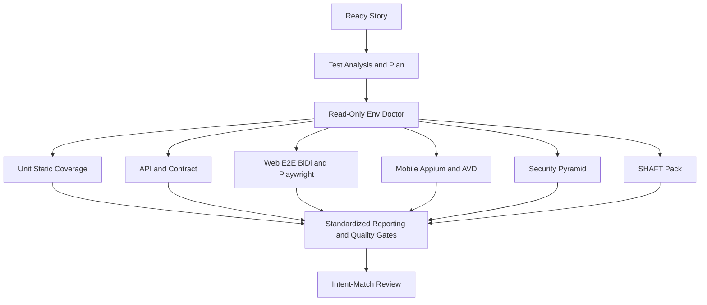

# Tester, five minutes

You do not need Java, a SHAFT checkout, or a production source tree. A story and a test plan are enough.

## From a ready story

1. Read the story intent and its acceptance criteria. Do not start from an implementation.
2. Write a test plan in the repo: scope, risks, in, out, and one mapping for every criterion. An unmapped criterion fails `unmapped-criteria`.
3. Add an executable check per criterion before calling the work tested. A pytest, a CLI proof, a Gherkin file that runs, or another check that can fail all qualify. A note that cannot fail does not.
4. Ask for an intent-match review in a fresh context. The question is whether the checks match the story, not whether they pass. A check that passes and contradicts a criterion fails `contradicts-criterion`.
5. The plan itself is reviewed. `missing-plan-review` fails closed. A later edit to the plan needs that review again.

`sdlc_flows.test_plan_gate`, `sdlc_flows.intent_match`, and `sdlc_flows.story_flow` are the mechanical gates. Judgement stays in the review.

Before any case is drafted, `sdlc_flows.thin_brief_gate` requires the request, how the feature works, and the code under test. A title alone is refused and the missing sources are named. A case already in the tree is not copied, and a human-edited test file is not overwritten unless the owner named that file. A gap draft still needs an executable check, or steps plus an expected result.

## Review floor

One adversarial review is mandatory. Two when the artefact is a public contract, irreversible, or outbound. Skipping that floor is not waived by a green job.

The [product owner](start-product-owner.md) writes the story. The [scrum master](start-scrum-master.md) runs refinement.

## Proof in this repo

```bash
python3 -m unittest tests.scripts.test_sdlc_flows_8059
```

## Test automation consultant workflow

After the five steps above, route the evidence. The story is ready before any tool runs. Test analysis and the plan come next. A read-only environment doctor (`scripts/ci/test_env_doctor.py`) checks the machine without installing or mutating it. Specialized testing skills then produce the checks. Standardized reporting and the quality gates collect one result. Intent-match review asks whether those checks match the story.

The consultant stack is on demand: [test engineering](../skills/test-engineering/SKILL.md), [API integration testing](../skills/api-integration-testing/SKILL.md), [web end-to-end automation](../skills/web-e2e-automation/SKILL.md), [mobile testing](../skills/mobile-testing/SKILL.md), [test environment setup](../skills/test-env-setup/SKILL.md), and [security audit](../skills/security-audit/SKILL.md). SHAFT pack routing stays with the detected project.


